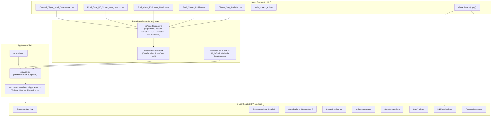

# PROJECT HANDOFF: LANDINSIGHT

> **Platform Title:** LANDINSIGHT — Digital Land Governance Intelligence Platform  
> **Repository Path:** `/Users/tsb/Desktop/LANDINSIGHT`  
> **Handoff Document Generation Date:** November 13, 2026  
> **Status:** MVP / Complete Static Single Page Application (Builds cleanly with zero errors)

---

## 1. Project Summary

- **What It Is:** LANDINSIGHT is a web-based, interactive data intelligence dashboard and decision-support platform designed to analyze, visualize, and benchmark digital land governance across all 36 Indian States and Union Territories (UTs). It presents the outputs of an unsupervised machine learning clustering study conducted on administrative data from the Digital India Land Records Modernization Programme (DILRMP).
- **The Problem It Solves:** Digital land records modernization across India is highly uneven across states due to differing state land tenure systems, cadastral surveying histories, and technical infrastructure. Policymakers, researchers, and administrators lacked a unified, interactive tool to explore multivariate governance profiles, identify peer state clusters, pinpoint spatial vs. textual record gaps, and evaluate clustering model diagnostics (e.g., K-Means cluster stability, silhouette validation, PCA projections).
- **Target Users:** Public policy researchers, land administration officials (Department of Land Resources / State Revenue Departments), spatial data analysts, and data science teams reviewing digital governance models.
- **Current Stage:** **MVP (Production-Ready Frontend Client)**. The client application is fully implemented in React 19 and Vite with client-side CSV parsing, an interactive Leaflet choropleth map, Recharts data visualizers, light/dark mode theming, and multi-state comparative tables. It compiles to static assets (`dist/`) without errors.
- **Evidence Sources:**
  - Application title & description: [index.html](file:///Users/tsb/Desktop/LANDINSIGHT/index.html#L6), [src/pages/ExecutiveOverview.tsx](file:///Users/tsb/Desktop/LANDINSIGHT/src/pages/ExecutiveOverview.tsx#L70-L73)
  - Research methodology & origin: [reference/EDA_DATA (5).ipynb](file:///Users/tsb/Desktop/LANDINSIGHT/reference/EDA_DATA%20(5).ipynb), [src/pages/ReportsDownloads.tsx](file:///Users/tsb/Desktop/LANDINSIGHT/src/pages/ReportsDownloads.tsx#L104-L122)

---

## 2. Tech Stack

All versions are extracted directly from [package.json](file:///Users/tsb/Desktop/LANDINSIGHT/package.json):

### Core Frameworks & Runtime
- **Runtime / Language:** TypeScript `^7.0.2` (Target: `ES2020`), React `^19.3.1`, React DOM `^19.3.1`
- **Build Tool / Bundler:** Vite `^8.3.6` with `@vitejs/plugin-react` `^6.2.1` and `tsconfig.json` (`moduleResolution: "bundler"`, `isolatedModules: true`)
- **Routing:** `react-router-dom` `^7.18.5` (Browser-based declarative routing with lazy-loaded route modules)

### Styling & UI
- **CSS Framework:** Tailwind CSS `^4.3.5` via `@tailwindcss/vite` `^4.3.5` and PostCSS `^8.5.32`, Autoprefixer `^10.6.2`
- **Iconography:** `lucide-react` `^1.70.0`
- **Theme Support:** Custom CSS custom properties with `@custom-variant dark` in [src/index.css](file:///Users/tsb/Desktop/LANDINSIGHT/src/index.css#L1-L43) and React Context in [src/lib/themeContext.tsx](file:///Users/tsb/Desktop/LANDINSIGHT/src/lib/themeContext.tsx)

### Data Visualization & Mapping
- **Interactive Charts:** `recharts` `^3.10.1` (Radar charts, Grouped bar charts, Horizontal gap bars, Line charts for K-evaluations, Donut/Pie charts)
- **Geospatial Mapping:** `leaflet` `^1.9.4`, `react-leaflet` `^5.0.0`, `@types/leaflet` `^1.9.22` (Choropleth polygon rendering with Basemaps Carto tiles)
- **Data Ingestion:** `papaparse` `^5.7.0`, `@types/papaparse` `^5.5.2` (Client-side asynchronous CSV streaming and dynamic parsing)

### Backend / Storage / APIs
- **Backend Architecture:** Serverless / Zero backend. All analytical datasets are static CSV and GeoJSON files served from `public/data/` and loaded in-memory into a unified React context on app mount.
- **External Network Dependency:** Leaflet tile layer fetches map tiles from OpenStreetMap / Carto CDN (`https://{s}.basemaps.cartocdn.com/light_nolabels/{z}/{x}/{y}{r}.png`) and Google Fonts (`Inter`).

---

## 3. Project Structure

```
/Users/tsb/Desktop/LANDINSIGHT/
├── dist/                              # Compiled production static output from `npm run build`
├── index.html                         # SPA entrypoint, sets viewport, page title, and Google Fonts
├── node_modules/                      # Installed npm package dependencies
├── package.json                       # Project manifests, scripts (dev, build, preview), dependencies
├── package-lock.json                  # Deterministic dependency lockfile
├── public/                            # Static public web assets served at root path
│   ├── assets/                        # Static analytical PNG exports from Python EDA research
│   │   ├── Binary_Service_Adoption_Heatmap.png   # 4 citizen services adoption heatmap across 36 states
│   │   ├── Governance_Indicator_Heatmap.png      # 9 percentage indicators heatmap across 36 states
│   │   └── PCA_Cluster_Visualization.png         # 2D PCA projection scatter plot (PC1 vs PC2)
│   └── data/                          # Core analytical datasets and boundaries
│       ├── Cleaned_Digital_Land_Governance.csv    # Master dataset (36 States/UTs × 17 columns)
│       ├── Cluster_Gap_Analysis.csv               # Ranked differences between Cluster 0 & Cluster 1 means
│       ├── Final_Cluster_Profiles.csv             # Mean values for Cluster 0 (n=7) and Cluster 1 (n=29)
│       ├── Final_Model_Evaluation_Metrics.csv     # 15 experimental runs (Models A, B, C for K=2..6)
│       ├── Final_State_UT_Cluster_Assignments.csv # Model C (K=2) cluster assignments for 36 States/UTs
│       └── india_states.geojson                   # Authentic polygon boundaries for 36 Indian States/UTs
├── reference/                         # Upstream research artifacts
│   └── EDA_DATA (5).ipynb             # Jupyter research notebook containing Python K-Means & PCA pipeline
├── src/                               # Application source code
│   ├── App.tsx                        # Main application router with Suspense & Context Providers
│   ├── index.css                      # Tailwind v4 import, dark-mode CSS variables, button/card classes
│   ├── main.tsx                       # React 19 DOM root mount (`StrictMode`, Leaflet CSS import)
│   ├── vite-env.d.ts                  # Vite client TypeScript definitions
│   ├── components/                    # Reusable React components
│   │   ├── charts/                    # Recharts charting components
│   │   │   ├── ClusterDistributionPie.tsx # Donut pie chart of cluster membership (7 vs 29)
│   │   │   └── ComparisonBarChart.tsx     # Horizontal & vertical grouped bar charts
│   │   ├── layout/                    # Page scaffolding & chrome
│   │   │   ├── AppLayout.tsx              # Shell with collapsible sidebar, header, and route outlet
│   │   │   ├── Sidebar.tsx                # Left navigation bar with Lucide icons and collapse toggle
│   │   │   └── ThemeToggle.tsx            # Light/Dark mode toggle button with sun/moon icons
│   │   └── ui/                        # Low-level UI display primitives
│   │       ├── ClusterBadge.tsx           # Styled cluster pill badge with dynamic indicator colors
│   │       ├── ErrorState.tsx             # Error boundary presentation with retry button
│   │       ├── LoadingState.tsx           # Centered spinner with customizable status message
│   │       └── StatCard.tsx               # Metric summary card with label, value, subtitle, and trend
│   ├── lib/                           # Core utilities, context, and data loaders
│   │   ├── constants.ts               # Feature definitions, color palettes, nav routes, metadata
│   │   ├── dataContext.tsx            # Global DataProvider context exposing parsed AppData
│   │   ├── dataLoader.ts              # Robust PapaParse loader, column validators, null sanitizers
│   │   ├── themeContext.tsx           # LocalStorage-backed theme provider ('light' | 'dark')
│   │   └── utils.ts                   # Formatting helpers (`formatPercent`, `toTitleCase`, `mean`, etc.)
│   ├── pages/                         # 9 lazy-loaded SPA view modules
│   │   ├── ClusterIntelligence.tsx    # Cluster 0 vs Cluster 1 deep dive, means, and profile cards
│   │   ├── ExecutiveOverview.tsx      # Executive dashboard with national KPIs, pie chart, key insights
│   │   ├── GapAnalysis.tsx            # Ranked absolute gaps between clusters with filter controls
│   │   ├── GovernanceMap.tsx          # Leaflet India map colored by cluster with interactive side panel
│   │   ├── IndicatorAnalytics.tsx     # National indicator bar distributions and min/max leaderboards
│   │   ├── MLModelInsights.tsx        # K-Means evaluation curves (K=2..6), PCA plot, metrics table
│   │   ├── ReportsDownloads.tsx       # Repository of downloadable CSV datasets and PNG figures
│   │   ├── StateComparison.tsx        # Multi-entity comparative tool (select 2 to 4 States/UTs)
│   │   └── StateExplorer.tsx          # Individual state search, radar chart vs cluster mean, metrics
│   └── types/                         # TypeScript interfaces
│       └── data.ts                    # Interfaces for all 5 CSV schemas, enriched state data, AppData
├── tailwind.config.js                 # Tailwind CSS configuration extending colors and font families
├── tsconfig.json                      # TypeScript configuration with strict checks and path alias `@/*`
├── tsconfig.tsbuildinfo               # TypeScript incremental build cache
└── vite.config.ts                     # Vite build configuration (React plugin, Tailwind plugin, alias)
```

---

## 4. Architecture

### System Flow
1. **Bootstrap:** [src/main.tsx](file:///Users/tsb/Desktop/LANDINSIGHT/src/main.tsx) mounts the React 19 application wrapped in `ThemeProvider` ([src/lib/themeContext.tsx](file:///Users/tsb/Desktop/LANDINSIGHT/src/lib/themeContext.tsx)) and `DataProvider` ([src/lib/dataContext.tsx](file:///Users/tsb/Desktop/LANDINSIGHT/src/lib/dataContext.tsx)).
2. **Data Ingestion:** On mount, `DataProvider` calls `loadAllDatasets()` in [src/lib/dataLoader.ts](file:///Users/tsb/Desktop/LANDINSIGHT/src/lib/dataLoader.ts).
   - Concurrently fetches 5 CSV files via `Promise.all`:
     1. `/data/Cleaned_Digital_Land_Governance.csv`
     2. `/data/Final_State_UT_Cluster_Assignments.csv`
     3. `/data/Final_Model_Evaluation_Metrics.csv`
     4. `/data/Final_Cluster_Profiles.csv`
     5. `/data/Cluster_Gap_Analysis.csv`
   - Validates required column headers for each file.
   - Detects and rejects duplicate or blank `State_UT` names.
   - Enforces 1-to-1 matching between governance records and cluster assignments (throws if any state is missing).
   - Sanitizes numerical values, ensuring empty/NaN strings become strict `null` instead of `0`.
   - Produces `enrichedStates` by joining `StateGovernanceData` with `ClusterAssignment`.
   - Asserts total state count is exactly 36 (national scope).
3. **Routing & Presentation:** [src/App.tsx](file:///Users/tsb/Desktop/LANDINSIGHT/src/App.tsx) renders `AppLayout` with a sticky header and sidebar. Pages are React lazy components loaded on demand with `Suspense`.
4. **Geospatial Mapping:** [src/pages/GovernanceMap.tsx](file:///Users/tsb/Desktop/LANDINSIGHT/src/pages/GovernanceMap.tsx) independently fetches `/data/india_states.geojson`, matches polygons to state data via `GEOJSON_TO_CSV_NAME` normalization map, and renders an SVG/Canvas Leaflet choropleth.

### Architecture Diagram



---

## 5. Setup & Run Instructions

### Prerequisites
- Node.js (v18.0.0 or higher recommended for React 19 and Vite 8)
- npm (bundled with Node.js)

### Environment Variables
- **No environment variables required.** The application has no `.env` file or API secrets. All data is bundled and loaded from `/data/` and `/assets/`.

### Installation
```bash
# Navigate to the workspace root
cd /Users/tsb/Desktop/LANDINSIGHT

# Install dependencies (already completed in workspace)
npm install
```

### Running Locally (Development)
```bash
npm run dev
# Vite will start a local dev server (typically http://localhost:5173/)
```

### Building for Production
```bash
npm run build
# Executes: tsc -b && vite build
# Production output is written to: /Users/tsb/Desktop/LANDINSIGHT/dist/
```
*(Verified: `npm run build` runs in ~300ms with zero TypeScript or bundling errors.)*

### Previewing the Production Build
```bash
npm run preview
# Serves the contents of dist/ locally for verification
```

### Deployment
- The build artifact is a 100% static client in `dist/`.
- It can be deployed directly to any static web hosting provider (e.g., Cloudflare Pages, Vercel, Netlify, GitHub Pages, Firebase Hosting, AWS S3/CloudFront) with single-page application rewrite rules directing all paths `/*` to `/index.html`.

---

## 6. Planning & Decisions

### Original Goals (from Jupyter Notebook & Page Code)
1. Ingest official DILRMP data covering all 36 Indian States and UTs.
2. Conduct feature correlation analysis to eliminate redundant or uninformative variables.
3. Train and compare multiple K-Means clustering configurations across cluster counts $K \in [2, 6]$.
4. Assess cluster quality using rigorous mathematical metrics:
   - Within-Cluster Sum of Squares (WCSS)
   - Silhouette Score
   - Davies-Bouldin Index (DBI)
   - Cluster Stability via Mean Adjusted Rand Index (ARI) over multiple random seed runs
5. Present the final selected model in an executive-ready web dashboard with full state drill-down.

### Key Design Decisions & Rationale
- **Selection of Model C ($K = 2$) as Active Baseline:**
  - *Model A (14 features baseline):* Retained all candidate features, yielding a Silhouette of 0.3810 at $K=2$.
  - *Model B (12 features):* Removed correlated pairs (`Villages_CLR_Completed_Pct` and `Land_Parcel_ULPIN_Pct`), but yielded a lower Silhouette of 0.3769.
  - *Model C (13 features):* Kept spatial coverage metrics while dropping only `Auto_Mutation` (a near zero-variance rare binary feature). Model C achieved the highest Silhouette Score (**0.4076**) and the lowest Davies-Bouldin Index (**1.1524**) at $K=2$, with perfect stability ($\text{ARI} = 1.0000, \text{Std} = 0.0000$).
  - *Rationale documented in:* [src/lib/constants.ts](file:///Users/tsb/Desktop/LANDINSIGHT/src/lib/constants.ts#L198-L223), [src/pages/MLModelInsights.tsx](file:///Users/tsb/Desktop/LANDINSIGHT/src/pages/MLModelInsights.tsx#L127-L166), [reference/EDA_DATA (5).ipynb](file:///Users/tsb/Desktop/LANDINSIGHT/reference/EDA_DATA%20(5).ipynb).
- **Cluster Definitions:**
  - **Cluster 0 (7 States/UTs, 19.4%):** Arunachal Pradesh, Delhi, Ladakh, Lakshadweep, Meghalaya, Mizoram, Nagaland. Characterized by developing/nascent digital cadastral infrastructure and lower RoR linkage.
  - **Cluster 1 (29 States/UTs, 80.6%):** Major agrarian and industrialized states. Near universal RoR computerization (98.8%) and high citizen digital service availability.
- **Client-Side CSV Ingestion vs. Hardcoded JSON:**
  - CSV files in `public/data/` were preserved in their native tabular format rather than pre-compiled into static JSON. This allows researchers to swap in updated DILRMP CSV files without needing to recompile code, provided the column schema is maintained.
- **Strict Null Preservation vs. Default to Zero:**
  - In [src/lib/dataLoader.ts](file:///Users/tsb/Desktop/LANDINSIGHT/src/lib/dataLoader.ts#L17-L30), missing values (`NaN`, empty strings, `null`) are strictly preserved as `null` rather than converted to `0`. This prevents unrecorded indicators from artificially skewing averages or appearing as "0% coverage".
- **Methodological Guardrails Against Causal Claims:**
  - Alerts are explicitly embedded in [src/pages/ExecutiveOverview.tsx](file:///Users/tsb/Desktop/LANDINSIGHT/src/pages/ExecutiveOverview.tsx#L213-L250) and [src/pages/GapAnalysis.tsx](file:///Users/tsb/Desktop/LANDINSIGHT/src/pages/GapAnalysis.tsx#L80-L94) stating that cluster groupings are *descriptive multivariate profiles*, not official rankings or causal evaluations of state governance efficacy.
- **PCA as Visual Projection Only:**
  - Code and UI notes in [src/pages/MLModelInsights.tsx](file:///Users/tsb/Desktop/LANDINSIGHT/src/pages/MLModelInsights.tsx#L278-L289) clarify that K-Means was run in the 13-dimensional standardized space, not on the 2D PCA projection (which accounts for 59.21% of total variance).

---

## 7. Work Completed

| Feature / Module | File Reference | Status | Details |
|---|---|---|---|
| **Data Loader & Validation Pipeline** | [src/lib/dataLoader.ts](file:///Users/tsb/Desktop/LANDINSIGHT/src/lib/dataLoader.ts) | **Done** | Implements PapaParse loader, column verification, duplicate detection, unmatched state verification, and join assertions across all 5 CSVs. |
| **Global Data Context** | [src/lib/dataContext.tsx](file:///Users/tsb/Desktop/LANDINSIGHT/src/lib/dataContext.tsx) | **Done** | Asynchronously loads all datasets on app start; exposes `data`, `isLoading`, `error`, and `reload`. |
| **Theme System** | [src/lib/themeContext.tsx](file:///Users/tsb/Desktop/LANDINSIGHT/src/lib/themeContext.tsx), [src/index.css](file:///Users/tsb/Desktop/LANDINSIGHT/src/index.css) | **Done** | Supports light and dark modes with persistent `localStorage` storage and OS preference detection. |
| **Navigation & App Layout** | [src/components/layout/AppLayout.tsx](file:///Users/tsb/Desktop/LANDINSIGHT/src/components/layout/AppLayout.tsx), [Sidebar.tsx](file:///Users/tsb/Desktop/LANDINSIGHT/src/components/layout/Sidebar.tsx) | **Done** | Collapsible sidebar (60px vs 240px), header with dynamic route titles, and active nav states. |
| **Executive Overview Page** | [src/pages/ExecutiveOverview.tsx](file:///Users/tsb/Desktop/LANDINSIGHT/src/pages/ExecutiveOverview.tsx) | **Done** | High-level KPI cards, cluster donut chart, top 5 indicator comparison, key observations, and methodological disclaimers. |
| **Interactive Governance Map** | [src/pages/GovernanceMap.tsx](file:///Users/tsb/Desktop/LANDINSIGHT/src/pages/GovernanceMap.tsx) | **Done** | Authentic India GeoJSON choropleth using Leaflet, name normalization map, hover tooltips, cluster filters, and interactive state inspection side panel. |
| **State / UT Explorer** | [src/pages/StateExplorer.tsx](file:///Users/tsb/Desktop/LANDINSIGHT/src/pages/StateExplorer.tsx) | **Done** | Searchable state directory, cluster filter, multivariate radar chart comparing state vs. cluster mean, and comprehensive benchmark table. |
| **Cluster Intelligence** | [src/pages/ClusterIntelligence.tsx](file:///Users/tsb/Desktop/LANDINSIGHT/src/pages/ClusterIntelligence.tsx) | **Done** | Detailed profiles of Cluster 0 vs Cluster 1, vertical bar comparisons for coverage and binary services, and complete cluster mean table. |
| **Indicator Analytics** | [src/pages/IndicatorAnalytics.tsx](file:///Users/tsb/Desktop/LANDINSIGHT/src/pages/IndicatorAnalytics.tsx) | **Done** | Indicator picker across all 13 features, min/max leaderboards, national mean, and sortable 36-state bar chart colored by cluster. |
| **State Comparison** | [src/pages/StateComparison.tsx](file:///Users/tsb/Desktop/LANDINSIGHT/src/pages/StateComparison.tsx) | **Done** | Dynamic multi-entity selector (up to 4 states), comparative grouped bar chart, and side-by-side metric matrix. |
| **Gap Analysis** | [src/pages/GapAnalysis.tsx](file:///Users/tsb/Desktop/LANDINSIGHT/src/pages/GapAnalysis.tsx) | **Done** | Ranked absolute divergence between clusters, category filters, top gap highlight card, and complete gap data table. |
| **ML Model Insights** | [src/pages/MLModelInsights.tsx](file:///Users/tsb/Desktop/LANDINSIGHT/src/pages/MLModelInsights.tsx) | **Done** | Model architecture cards, trajectory curves for Silhouette and DBI across $K=2..6$, embedded PCA 2D projection figure with technical commentary, and full 15-run metrics table. |
| **Reports & Downloads** | [src/pages/ReportsDownloads.tsx](file:///Users/tsb/Desktop/LANDINSIGHT/src/pages/ReportsDownloads.tsx) | **Done** | Download cards for all 5 CSV datasets, 3 high-res PNG visual assets, and the 1.0 MB `india_states.geojson` boundary file. |
| **Build Configuration** | [vite.config.ts](file:///Users/tsb/Desktop/LANDINSIGHT/vite.config.ts), [tsconfig.json](file:///Users/tsb/Desktop/LANDINSIGHT/tsconfig.json) | **Done** | Configured with path alias `@/*`, Tailwind Vite plugin, and clean TypeScript compilation. |

---

## 8. Work In Progress

- **Current Session End State:** The frontend development is **feature-complete for the current milestone**. The application compiles cleanly to `dist/`, all 9 routes are functional, and all datasets load and validate without errors.
- **Uncommitted Changes:** There is currently no active git tracking in the folder (see Section 10). No dirty files or half-implemented features were found in `src/`.
- **Last Active File:** [src/pages/ReportsDownloads.tsx](file:///Users/tsb/Desktop/LANDINSIGHT/src/pages/ReportsDownloads.tsx) and [src/lib/dataLoader.ts](file:///Users/tsb/Desktop/LANDINSIGHT/src/lib/dataLoader.ts) were among the last modified application files during the dataset validation phase.

---

## 9. Remaining Work & Backlog

The following tasks represent logical enhancements and tech-debt remediation for subsequent development phases:

### Priority 1: Version Control & Automated Testing (Immediate Tech Debt)
- [ ] **Initialize Git Repository:** Run `git init`, commit existing workspace files, create `.gitignore` (ignoring `node_modules/`, `dist/`, `.DS_Store`, `tsconfig.tsbuildinfo`), and link to remote repository.
- [ ] **Automated Test Suite:** Currently there are **0 tests** (no Vitest, Jest, or React Testing Library installed). Add unit tests for:
  - `dataLoader.ts` (validation logic, null handling, duplicate detection).
  - `utils.ts` (`formatPercent`, `formatNumber`, `toTitleCase`, `mean`).
  - Core UI component rendering (`StatCard`, `ClusterBadge`).

### Priority 2: Geospatial & Visualization Refinements
- [ ] **Offline Leaflet Tile Support / Fallback:** The map currently requires internet access to load Carto basemap tiles from `basemaps.cartocdn.com`. Implement fallback styling or offline vector tiles if network connectivity is intermittent.
- [ ] **Mobile Responsiveness for Governance Map:** On small viewports (<768px), the map container height (620px) and side-by-side layout can be crowded. Add a collapsible bottom-sheet for the selected state panel on mobile screens.

### Priority 3: Data Export & Reporting Features
- [ ] **Dynamic PDF / Executive Brief Export:** Add client-side PDF export (using `jspdf` or `html2canvas`) allowing users to download a formatted 2-page executive summary for any selected State/UT from `StateExplorer.tsx`.
- [ ] **Export Filtered Tables to CSV:** Provide a "Download Filtered View" button on the table components in `StateExplorer.tsx` and `IndicatorAnalytics.tsx`.

---

## 10. Known Issues, Risks & Technical Debt

1. **No Version Control Repository in Workspace (`.git` is missing):**
   - *Fact:* Running `ls -d .git` returns `No such file or directory`. The folder is currently an untracked directory on disk.
   - *Risk:* Any accidental file deletions or overwrites cannot be rolled back with git.
2. **No Automated Test Coverage:**
   - *Fact:* There are no test scripts in `package.json` and no `.test.ts` or `.spec.tsx` files in the repository.
   - *Risk:* Regressions in dataset parsing or utility functions could pass undetected without manual UI verification.
3. **External Tile Dependency:**
   - *Fact:* In [src/pages/GovernanceMap.tsx](file:///Users/tsb/Desktop/LANDINSIGHT/src/pages/GovernanceMap.tsx#L323), Leaflet loads tiles from `https://{s}.basemaps.cartocdn.com/light_nolabels/{z}/{x}/{y}{r}.png`.
   - *Risk:* If the user runs the app in an offline environment or behind a strict proxy, the choropleth polygons will render over a blank grid background.
4. **GeoJSON Boundary Key Fragility:**
   - *Fact:* In [src/pages/GovernanceMap.tsx](file:///Users/tsb/Desktop/LANDINSIGHT/src/pages/GovernanceMap.tsx#L27-L64), `GEOJSON_TO_CSV_NAME` hardcodes exact string mappings between the GeoJSON property `ST_NM` and CSV `State_UT`.
   - *Risk:* If `india_states.geojson` is ever replaced with a different boundary file using alternative spelling (e.g., "Jammu and Kashmir" instead of "Jammu & Kashmir"), matching will silently fail and polygons will display gray "N/A" styling.
5. **Client-Side CSV Parsing Overhead:**
   - *Fact:* PapaParse parses all 5 CSV files in the browser on every fresh page load.
   - *Mitigation in place:* Datasets are very compact (~36 rows each, total <100 KB), so parsing takes under 15ms. However, if state records expand to district/village-level granularity (e.g., 600,000+ villages), client-side CSV parsing will freeze the main thread and will require moving to IndexedDB or a dedicated backend API.

---

## 11. Conventions & Standards

When continuing work on this project, adhere to the following established conventions:

- **Strict TypeScript & Null Safety:**
  - Never cast missing numerical data to `0`. Always use `number | null`.
  - Format metrics using the helper functions in [src/lib/utils.ts](file:///Users/tsb/Desktop/LANDINSIGHT/src/lib/utils.ts) (`formatNumber`, `formatPercent`, `formatBinary`), which output explicit `'N/A'` or `'Unavailable'` badges when data is absent.
- **Color Identity & Semantics:**
  - Always reference cluster colors from `CLUSTER_CONFIG` in [src/lib/constants.ts](file:///Users/tsb/Desktop/LANDINSIGHT/src/lib/constants.ts#L179-L196):
    - **Cluster 0:** `#4A7FB5` (Blue-slate)
    - **Cluster 1:** `#D4A03C` (Amber-gold)
  - For general UI chrome, use CSS variables defined in [src/index.css](file:///Users/tsb/Desktop/LANDINSIGHT/src/index.css) (e.g., `var(--color-surface)`, `var(--color-border)`, `var(--color-text-primary)`).
- **Naming Conventions:**
  - Pages: PascalCase in `src/pages/` (e.g., `ExecutiveOverview.tsx`, `MLModelInsights.tsx`).
  - Reusable Components: PascalCase in `src/components/{charts,layout,ui}/`.
  - Utilities and contexts: camelCase in `src/lib/` (e.g., `dataLoader.ts`, `dataContext.tsx`).
  - Types: Interfaces in `src/types/data.ts` matching CSV column names exactly (e.g., `Map_Digitization_Pct`, `State_UT`).
- **Path Aliasing:**
  - Use `@/` for imports from `src/` (configured in `vite.config.ts` and `tsconfig.json`).

---

## 12. Open Questions

1. **Version Control Integration:**
   - *Question:* Should this directory be initialized as a standalone git repository, or is it intended to be pushed to an existing remote GitHub/GitLab repository?
2. **Data Refresh Cadence:**
   - *Question:* How often is DILRMP data updated by the Ministry/Department, and will future updates include historical longitudinal snapshots (e.g., 2024 vs 2025 progress)?
3. **Production Hosting Target:**
   - *Question:* What is the intended deployment target (e.g., Vercel, Cloudflare Pages, S3, internal government cloud)? This determines whether specific routing rewrites or server configurations are needed.

---

## 13. Recommended First Steps for the Next Agent

To resume work seamlessly, the incoming engineer or agent should execute the following 5 actions:

1. **Initialize Git & Create Initial Commit:**
   ```bash
   cd /Users/tsb/Desktop/LANDINSIGHT
   git init
   # Create .gitignore ignoring node_modules, dist, .DS_Store, tsconfig.tsbuildinfo
   git add .
   git commit -m "feat: complete LANDINSIGHT digital governance intelligence MVP"
   ```
2. **Verify Local Development Server:**
   ```bash
   npm run dev
   # Open browser at http://localhost:5173/ and confirm all 9 navigation tabs render
   ```
3. **Execute Production Build Verification:**
   ```bash
   npm run build
   # Verify tsc -b and vite build complete with 0 errors
   ```
4. **Install Testing Framework:**
   - Install Vitest and React Testing Library:
     ```bash
     npm install -D vitest @testing-library/react @testing-library/jest-dom jsdom
     ```
   - Add a test script `"test": "vitest run"` to `package.json`.
   - Write an initial test suite for `src/lib/dataLoader.ts` to assert that 36 states and all 5 CSV schemas validate properly.
5. **Inspect Research Notebook:**
   - Open and review [reference/EDA_DATA (5).ipynb](file:///Users/tsb/Desktop/LANDINSIGHT/reference/EDA_DATA%20(5).ipynb) to understand the underlying Python Scikit-Learn pipeline used to generate the cluster assignments and metrics.

